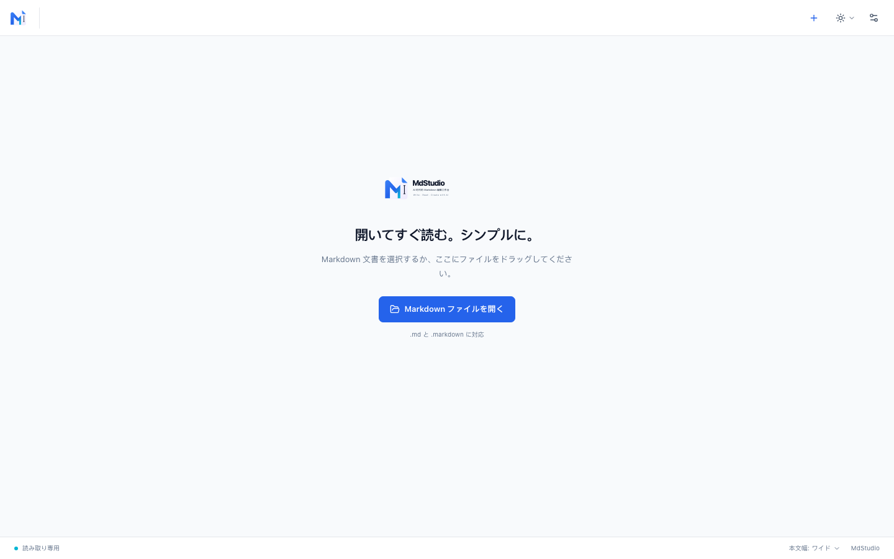
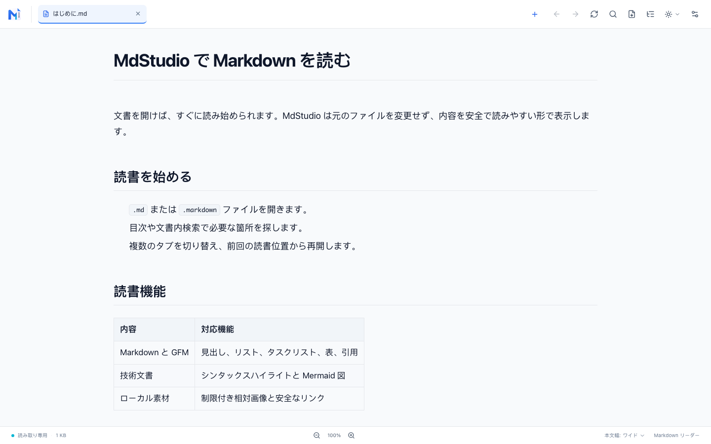
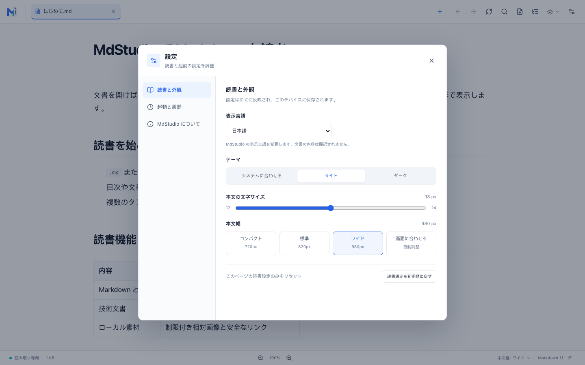
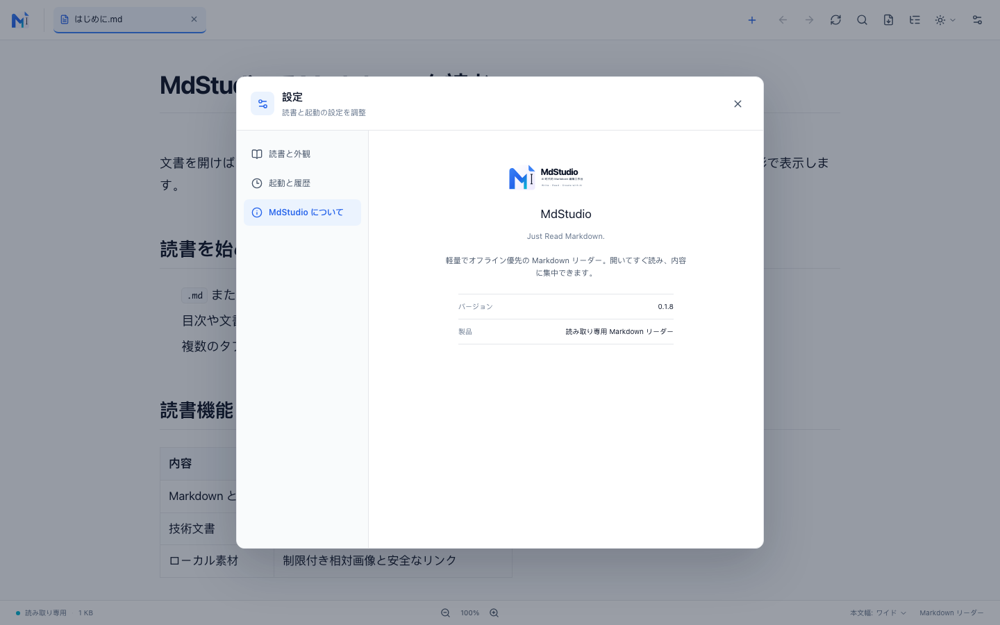

# MdStudio

[简体中文](README.zh-CN.md) · [English](README.md) · [日本語](README.ja.md)

**MdStudio v0.2.0** は、Markdown、PDF、OFD をローカルで閲覧する読み取り専用デスクトップアプリです。ファイルを開くだけですぐに読め、1 つのウィンドウで複数のタブを使えます。

> Just Read Markdown. ファイルを開いて、すぐに読む。



## スクリーンショット

### Markdown 文書の閲覧



### 設定



### MdStudio について



## 対応形式

| 形式 | 閲覧機能 | 備考 |
| --- | --- | --- |
| Markdown（`.md`、`.markdown`） | Markdown/GFM、コードハイライト、Mermaid、KaTeX 数式、GitHub Alerts、ローカル画像とリンク | 読み取り専用で、元ファイルを変更しません。 |
| PDF（`.pdf`） | 連続表示、ページ移動、拡大縮小、回転、テキスト選択、検索、サムネイル、利用可能なアウトライン | PDF.js、Worker、必要なリソースをアプリに同梱しています。スキャン画像の OCR はありません。暗号化 PDF のパスワード入力には未対応です。 |
| OFD（`.ofd`） | ローカルページ表示、ページ移動、拡大縮小、回転、サムネイル。テキストレイヤーがある場合は検索可能 | 互換性はまだ実験段階です。フォントが不足すると中国語が表示されない場合があります。システムフォント代替で改善する文書もありますが、中国語フォントはアプリに同梱していません。印章を表示しても署名の有効性は検証しません。 |

ファイル選択、ドラッグ＆ドロップ、複数形式のタブ表示を利用できます。システムのファイル関連付けと Windows/Linux の動作は、各プラットフォームでまだ検証していません。

## 閲覧機能

- 1 つのウィンドウで複数の文書を開けます。タブごとに読書位置と検索状態を保持します。
- Markdown は目次、文書内検索、読書履歴の戻る／進むに対応します。PDF/OFD はページ移動に対応し、利用可能な場合はサムネイルやアウトラインを表示します。
- ライト、ダーク、システム連動テーマを選択できます。Markdown の文字サイズと本文幅を調整でき、「画面に合わせる」こともできます。
- UI は日本語、簡体字中国語、英語に対応しています。
- 前回のタブと読書位置を復元し、設定から最近使ったファイルを管理できます。
- Mermaid と LaTeX 数式のリソースはアプリに同梱され、CDN を必要としません。

## 既知の制限

- OFD の互換性は未完成です。文書が指定するフォントや字形が利用できない場合、テキストが欠落することがあります。暗号化 OFD には未対応で、電子署名の有効性も検証しません。
- Markdown から PDF への出力は PDF 閲覧とは別の機能です。現在、出力が応答しなくなったり失敗したりする既知の問題があります。
- Windows と Linux では、macOS と同等のデスクトップ検証をまだ実施していません。

## セキュリティとデータの扱い

MdStudio は Markdown、PDF、OFD、画像、添付ファイルを編集しません。読書設定、タブセッション、最近使ったファイルのパス、読書位置はローカルに保存します。文書はアップロードされず、クラウドサービスやデータベースも使用しません。

Markdown の HTML は許可リストでサニタイズします。スクリプトは実行されず、危険な URL は除去され、外部画像も読み込みません。相対リソースは文書フォルダー内に制限します。HTTPS リンクはクリックした場合に限りシステムブラウザーで開きます。PDF.js、Mermaid、KaTeX、OFD Viewer のリソースはアプリに同梱され、オフラインで利用できます。

Markdown エディター、AI チャット、ワークスペース、アカウント、クラウド同期、プラグインシステムは含まれていません。

## インストールと起動

### macOS アプリバンドル

ビルド後の出力先：

```text
src-tauri/target/release/bundle/macos/MdStudio.app
```

### ソースから起動する

Node.js、pnpm、stable Rust、および Tauri 2 の各プラットフォーム向け開発依存関係が必要です。詳細は [Tauri v2 の前提条件](https://v2.tauri.app/start/prerequisites/) を参照してください。

```bash
pnpm install
pnpm tauri dev
```

現在のプラットフォーム向けアプリをビルドします。

```bash
pnpm tauri build
```

macOS の `.app` バンドルだけをビルドします。

```bash
pnpm tauri build --bundles app
```

フロントエンドの本番ビルドには `pnpm build` を使います。

## キーボードショートカット

| 操作 | ショートカット |
| --- | --- |
| ファイルを開く | `⌘/Ctrl + O` |
| 現在のタブを閉じる | `⌘/Ctrl + W` |
| 文書内を検索 | `⌘/Ctrl + F` |
| Markdown 文字サイズ／ページ倍率をリセット | `⌘/Ctrl + 0` |
| タブを切り替える | `Ctrl + Tab` / `Ctrl + Shift + Tab` |
| 設定 | `⌘/Ctrl + ,` |
| 読書履歴を戻る／進む | `⌘ + [` / `⌘ + ]`、Windows/Linux では `Alt + ←` / `Alt + →` |

ショートカットはプラットフォームによって異なる場合があります。文書、検索、ナビゲーション、テーマ、再読み込み、読書履歴は上部ツールバーからも利用できます。

## 技術スタック

- デスクトップ：Rust、Tauri 2
- Markdown：Comrak、Syntect、Ammonia
- PDF：PDF.js（`pdfjs-dist`）
- OFD：OFDRW Viewer UI と Engine
- UI：React、TypeScript、Tailwind CSS、Vite

## ライセンス

MdStudio は [MIT ライセンス](LICENSE) で配布されています。
