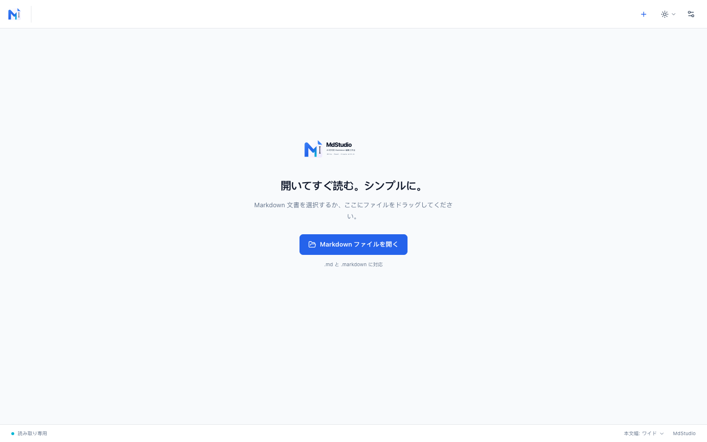
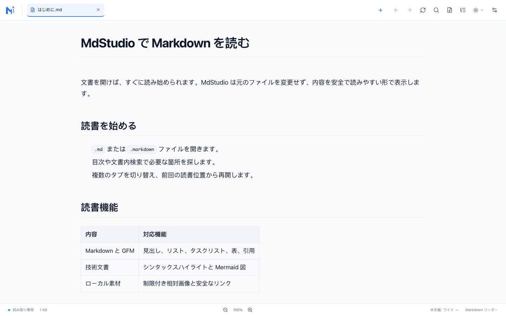
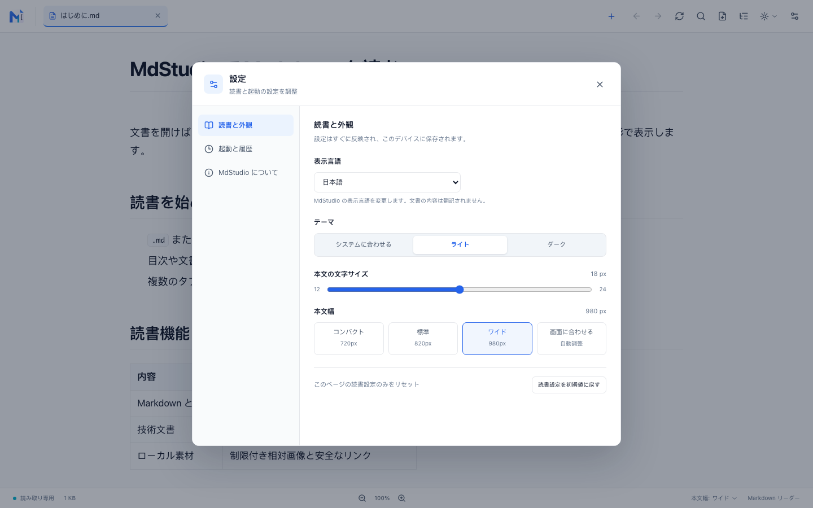
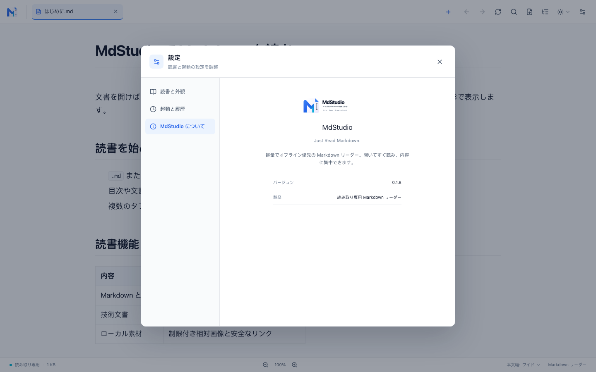

# MdStudio

[简体中文](README.zh-CN.md) · [English](README.md) · [日本語](README.ja.md)

**MdStudio v0.1.8** は、軽量で読み取り専用の Markdown デスクトップリーダーです。ファイルを開くだけですぐに読めます。複数タブ、技術文書の表示、ローカルの読書設定に対応しています。

> 開いたらすぐ読める。シンプルで、速く、読みやすく。



## スクリーンショット

### Markdown 文書の閲覧



### 設定



### MdStudio について



## 機能

- ファイル選択、ドラッグ＆ドロップ、OS の「このアプリで開く」から `.md` と `.markdown` を開けます。1 つのウィンドウで複数の文書を読めます。
- 見出し、リスト、タスクリスト、表、引用、リンク、画像、コードブロックなどの CommonMark / GFM を表示します。コードのシンタックスハイライトはアプリ内のリソースを使用します。
- Mermaid 図を自動表示します。ソースの表示・コピーに加え、ビューアで拡大縮小、パン、ウィンドウに合わせる操作ができます。
- ローカル文書のリソースを表示します。相対画像は文書フォルダー内からのみ読み込みます。表とコードブロックは必要に応じて個別に横スクロールできます。
- 目次、文書内検索、戻る／進むの履歴で移動できます。検索状態と読書位置はタブごとに保持されます。
- ライト、ダーク、システム連動テーマを選べます。文字サイズと本文幅を調整でき、「画面に合わせる」にも対応します。
- UI の言語は日本語、簡体字中国語、英語から選べます。
- 前回のタブを復元し、読書位置を記憶できます。設定から最近使ったファイルを管理できます。
- macOS と Windows のコードパスに A4 縦向き PDF 出力を実装しています。出力ページではリーダーのツールバー、ヘッダー、フッターを非表示にします。現在のプロジェクト報告では Windows の実行時動作は未検証です。Linux では直接 PDF 出力をサポートしていません。

## セキュリティとデータの扱い

MdStudio は読み取り専用です。Markdown や画像を編集・保存・変更しません。読書設定、タブセッション、最近使ったファイルのパス、読書位置はローカルに保存され、文書本文はキャッシュされません。

Markdown から生成した HTML は許可リストでサニタイズします。スクリプトは実行されず、危険な URL は除去されます。相対画像は文書フォルダーの境界と対応形式を検証します。外部画像は読み込みません。HTTPS リンクはユーザーがクリックした場合に限り、システムブラウザーで開きます。文書をアップロードせず、クラウドサービスやデータベースも使用しません。

Markdown エディター、AI チャット、ワークスペース管理、アカウント、クラウド同期、プラグインシステムは含まれていません。

## インストールと起動

### ビルド済み macOS アプリを使う

アプリバンドルの生成先：

```text
src-tauri/target/release/bundle/macos/MdStudio.app
```

### ソースから起動する

Node.js、pnpm、stable Rust、および Tauri 2 の各プラットフォーム向け開発依存関係が必要です。詳細は [Tauri v2 の前提条件](https://v2.tauri.app/start/prerequisites/) を参照してください。

```bash
pnpm install
pnpm tauri dev
```

現在のプラットフォーム向けアプリをビルドします。

```bash
pnpm tauri build
```

macOS の `.app` バンドルだけをビルドします。

```bash
pnpm tauri build --bundles app
```

フロントエンドの本番ビルドには `pnpm build` を使います。

## キーボードショートカット

| 操作 | ショートカット |
| --- | --- |
| ファイルを開く | `⌘/Ctrl + O` |
| 現在のタブを閉じる | `⌘/Ctrl + W` |
| 文書内を検索 | `⌘/Ctrl + F` |
| 文字サイズを初期値に戻す | `⌘/Ctrl + 0` |
| タブを切り替える | `Ctrl + Tab` / `Ctrl + Shift + Tab` |
| 設定 | `⌘/Ctrl + ,` |
| 読書履歴を戻る／進む | `⌘ + [` / `⌘ + ]`、Windows と Linux では `Alt + ←` / `Alt + →` |

ショートカットはプラットフォームによって異なる場合があります。ファイル、検索、目次、テーマ、再読み込み、読書履歴の操作は上部ツールバーからも利用できます。

## 技術スタック

- デスクトップ：Rust、Tauri 2
- Markdown：Comrak、Syntect、Ammonia
- UI：React、TypeScript、Tailwind CSS、Vite
- 図表：必要な場合に読み込む Mermaid、DOMPurify による SVG サニタイズ

Mermaid などの実行時リソースはアプリに同梱され、CDN に依存しません。

## ライセンス

MdStudio は [MIT ライセンス](LICENSE) で配布されています。
