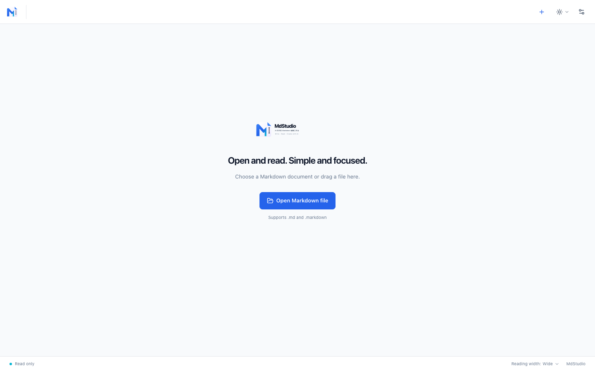
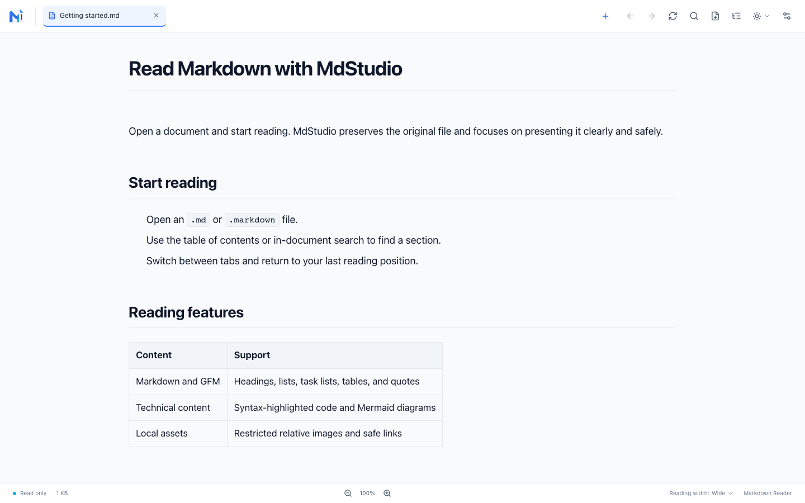
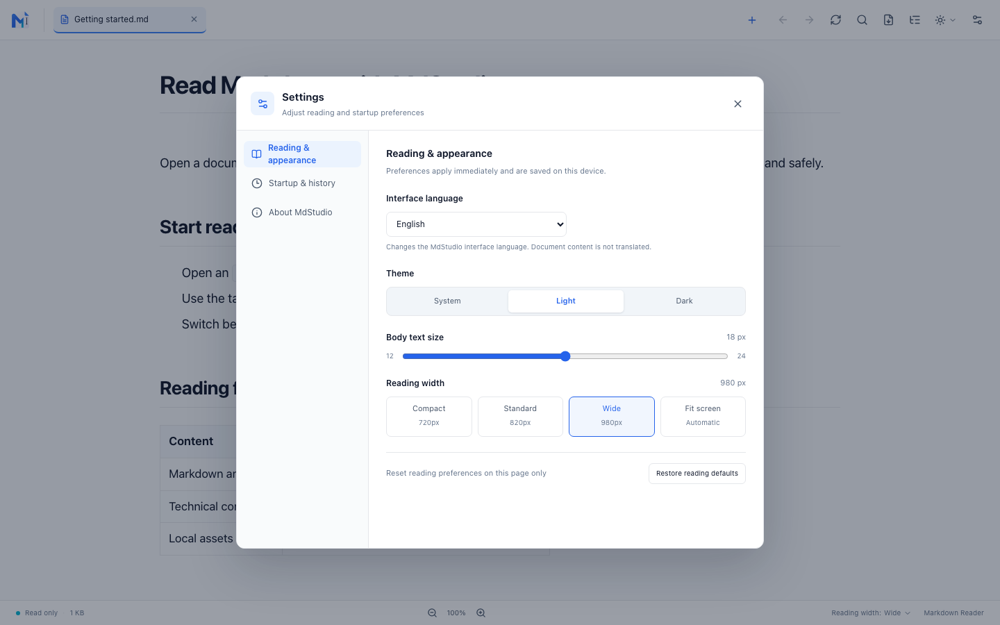
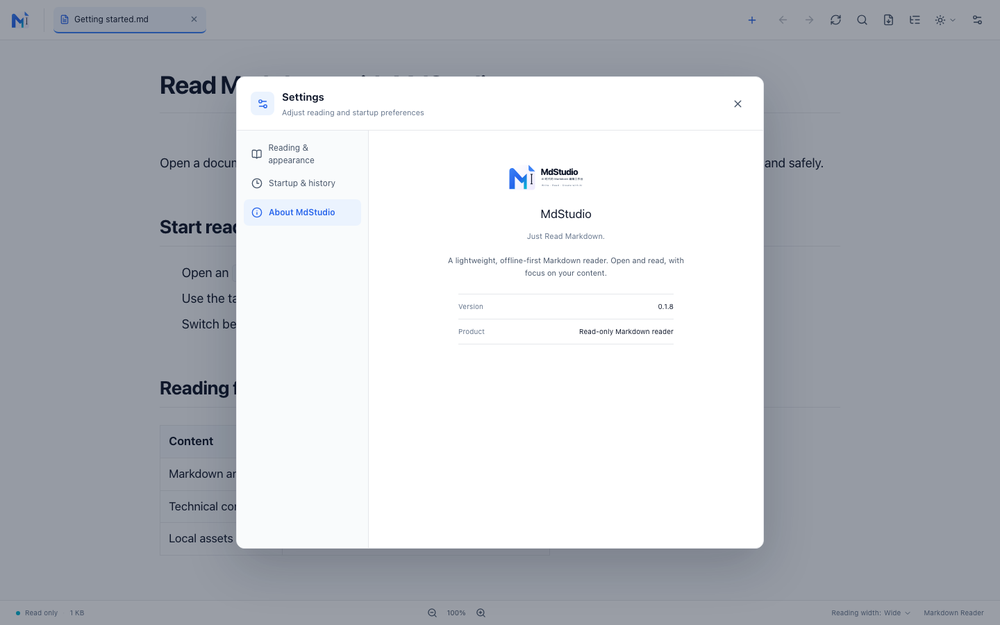

# MdStudio

[English](README.md) · [简体中文](README.zh-CN.md) · [日本語](README.ja.md)

**MdStudio v0.3.0** is a local desktop reader for Markdown, PDF, and OFD, with folder workspaces and lightweight Markdown source editing.

> Just read Markdown. Open a document and start reading.



## Screenshots

### Markdown reading



### Settings



### About MdStudio



## Document formats

| Format | Reading support | Notes |
| --- | --- | --- |
| Markdown (`.md`, `.markdown`) | Markdown/GFM, code highlighting, Mermaid, KaTeX formulas, GitHub Alerts, local images and links; CodeMirror source editing | Explicit save, save as, conflict protection, undo/redo, and unsaved-change prompts; no auto-save. |
| PDF (`.pdf`) | Continuous pages, page navigation, zoom, rotation, text selection, search, thumbnails and available outline | PDF.js and its worker and supporting resources are bundled locally. Scanned documents have no OCR; encrypted PDFs have no password prompt. |
| OFD (`.ofd`) | Local page viewing, navigation, zoom, rotation, thumbnails and text-layer search when text is available | Compatibility is experimental. Missing fonts can leave Chinese text blank. System font substitution helps some files, but no bundled Chinese fallback font is included. Signatures are displayed but never verified. |

The file picker, drag and drop, and mixed-format tabs are available in the current app. System file association and Windows/Linux behavior have not been verified across platforms.

## Reading features

- Open multiple documents in one window. Each tab keeps its own reading position and search state.
- Navigate Markdown with a table of contents, in-document search, and back/forward reading history. PDF and OFD use page navigation and show thumbnails or an outline when available.
- Choose light, dark, or system theme; adjust Markdown font size and reading width, including Fit to screen.
- Use the interface in English, Simplified Chinese, or Japanese.
- Restore tabs, remember reading positions, and manage recent files in Settings.
- Open a folder workspace with a lazy-loaded tree for Markdown, PDF, and OFD. MdStudio remembers the last workspace and restores it on startup.
- Edit Markdown source in CodeMirror 6. Only `.md` and `.markdown` files can be saved; PDF and OFD remain read-only.
- Render Mermaid diagrams and LaTeX formulas with local assets; no CDN is required.

## Known limitations

- OFD compatibility is incomplete. Some documents still lose text when their declared fonts or glyphs are unavailable. Encrypted OFD files are unsupported, and signature validity is not checked.
- Markdown-to-PDF export is separate from PDF reading and has a known issue: it may become unresponsive or fail on some documents.
- Windows and Linux have not yet received the same desktop verification as macOS.

## Security and data boundaries

Markdown source editing writes only after an explicit save. PDF, OFD, images, and attachments remain read-only. Reading preferences, workspace path, tab sessions, recent-file paths, and reading positions stay on the local machine. Documents are not uploaded to MdStudio or a cloud service.

Markdown HTML is sanitized with an allowlist. Scripts do not run and unsafe URLs are removed. Relative resources are checked against the document directory. Safe HTTPS images may be loaded from their source host; that host receives a normal image request. HTTPS links open in the system browser only after the user clicks them. PDF.js, Mermaid, KaTeX, and OFD viewer resources are bundled with the app for offline use.

MdStudio does not include split-screen Markdown editing, AI chat, accounts, cloud sync, or a plugin system.

## Install and run

### Use the macOS app bundle

Build the app bundle at:

```text
src-tauri/target/release/bundle/macos/MdStudio.app
```

### Run from source

You need Node.js, pnpm, stable Rust, and the platform dependencies required by Tauri 2. See [Tauri v2 prerequisites](https://v2.tauri.app/start/prerequisites/).

```bash
pnpm install
pnpm tauri dev
```

Build the desktop app for the current platform:

```bash
pnpm tauri build
```

Build only the macOS `.app` bundle:

```bash
pnpm tauri build --bundles app
```

The frontend production build is `pnpm build`.

## Keyboard shortcuts

| Action | Shortcut |
| --- | --- |
| Open a file | `⌘/Ctrl + O` |
| Close the current tab | `⌘/Ctrl + W` |
| Search this document | `⌘/Ctrl + F` |
| Reset Markdown font size or page zoom | `⌘/Ctrl + 0` |
| Switch tabs | `Ctrl + Tab` / `Ctrl + Shift + Tab` |
| Settings | `⌘/Ctrl + ,` |
| Back/forward in reading history | `⌘ + [` / `⌘ + ]`; `Alt + ←` / `Alt + →` on Windows and Linux |

Shortcuts can vary by platform. The top toolbar also provides document, search, navigation, theme, refresh, and reading-history controls.

## Technology

- Desktop: Rust, Tauri 2
- Markdown: Comrak, Syntect, Ammonia
- PDF: PDF.js (`pdfjs-dist`)
- OFD: OFDRW Viewer UI and Engine
- UI: React, TypeScript, Tailwind CSS, Vite

## License

MdStudio is distributed under the [MIT License](LICENSE).
