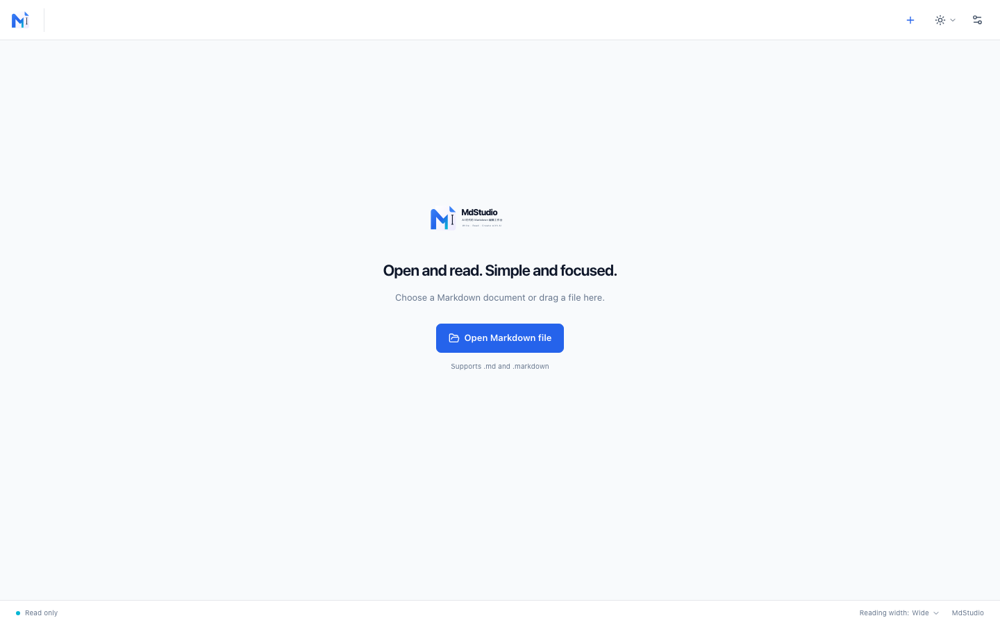
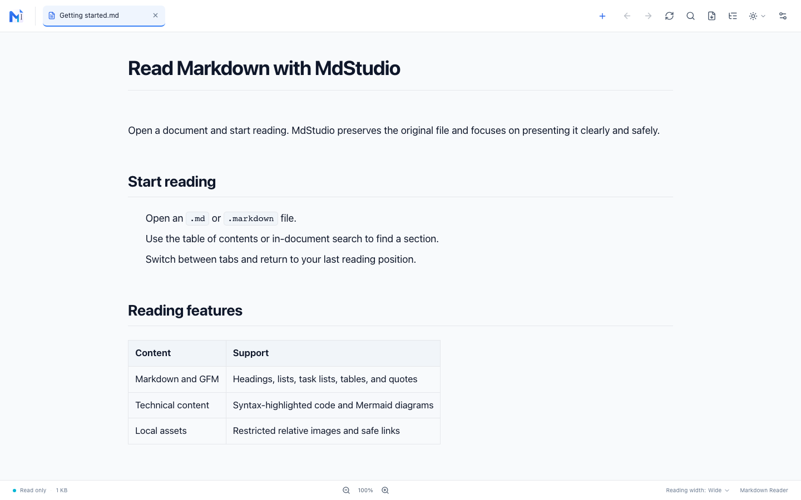
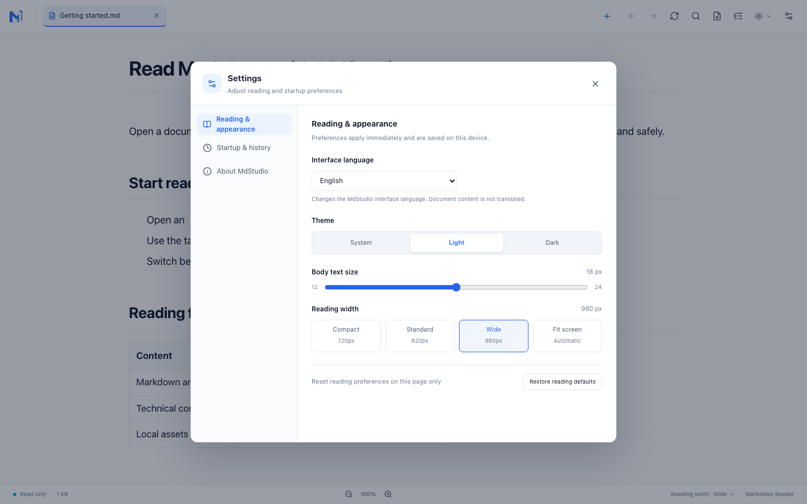
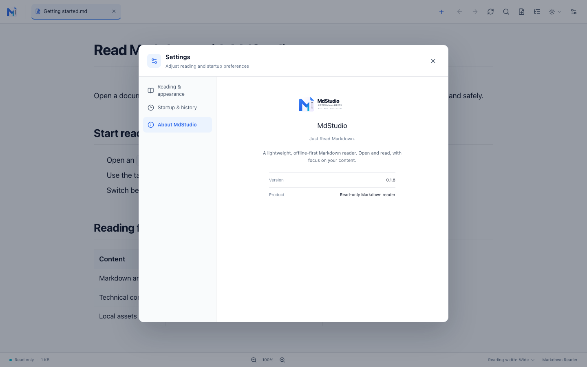

# MdStudio

[简体中文](README.zh-CN.md) · [English](README.md) · [日本語](README.ja.md)

**MdStudio v0.1.8** is a lightweight, read-only Markdown desktop reader. Open a document and start reading, with multi-tab navigation, technical-document rendering, and local reading preferences.

> Open and read. Simple, fast, focused.



## Screenshots

### Markdown reader



### Settings



### About MdStudio



## Features

- Open `.md` and `.markdown` files using the file picker, drag and drop, or the operating system's Open With flow. Read multiple documents in one window.
- Read CommonMark and GFM content, including headings, lists, task lists, tables, quotes, links, images, and code blocks with locally bundled syntax highlighting.
- View Mermaid diagrams by default, inspect or copy their source, and zoom, pan, or fit them to the window.
- Read local document assets. Relative images are loaded only from within the document directory; tables and code blocks scroll independently when needed.
- Navigate with the table of contents, in-document search, and back/forward history. Each tab keeps its own search state and reading position.
- Choose light, dark, or system theme; adjust font size and reading width, including Fit to screen.
- Use the interface in English, Simplified Chinese, or Japanese.
- Restore the previous tabs, remember reading positions, and manage recent files in Settings.
- A4 portrait PDF export is implemented for macOS and Windows code paths. Exported pages hide the reader toolbar, headers, and footers. Windows runtime behavior has not been verified in the current project report; direct PDF export is not implemented for Linux.

## Security and data boundaries

MdStudio is read-only: it does not edit or save Markdown files or modify images. Reading preferences, tab sessions, recent-file paths, and reading positions stay on the local machine; document contents are not cached.

Markdown HTML is sanitized with an allowlist. Scripts do not run, and unsafe URLs are removed. Relative images are checked against the document-directory boundary and supported file types. Remote images are not loaded. HTTPS links are opened in the system browser only after the user clicks them. Documents are not uploaded, and the app does not use cloud services or a database.

MdStudio does not include a Markdown editor, AI chat, workspace management, accounts, cloud sync, or a plugin system.

## Install and run

### Use the built macOS app

The app bundle is generated at:

```text
src-tauri/target/release/bundle/macos/MdStudio.app
```

### Run from source

You need Node.js, pnpm, stable Rust, and the platform dependencies required by Tauri 2. See [Tauri v2 prerequisites](https://v2.tauri.app/start/prerequisites/).

```bash
pnpm install
pnpm tauri dev
```

Build a desktop app for the current platform:

```bash
pnpm tauri build
```

Build only the macOS `.app` bundle:

```bash
pnpm tauri build --bundles app
```

The frontend production build is `pnpm build`.

## Keyboard shortcuts

| Action | Shortcut |
| --- | --- |
| Open a file | `⌘/Ctrl + O` |
| Close the current tab | `⌘/Ctrl + W` |
| Search this document | `⌘/Ctrl + F` |
| Reset font size | `⌘/Ctrl + 0` |
| Switch tabs | `Ctrl + Tab` / `Ctrl + Shift + Tab` |
| Settings | `⌘/Ctrl + ,` |
| Back/forward in reading history | `⌘ + [` / `⌘ + ]`; `Alt + ←` / `Alt + →` on Windows and Linux |

Shortcuts can vary by platform. The top toolbar also provides file, search, table-of-contents, theme, refresh, and reading-history controls.

## Technology

- Desktop: Rust, Tauri 2
- Markdown: Comrak, Syntect, Ammonia
- UI: React, TypeScript, Tailwind CSS, Vite
- Diagrams: Mermaid loaded on demand; SVG sanitized with DOMPurify

Mermaid and other runtime assets are bundled locally; no CDN is required.

## License

MdStudio is distributed under the [MIT License](LICENSE).
