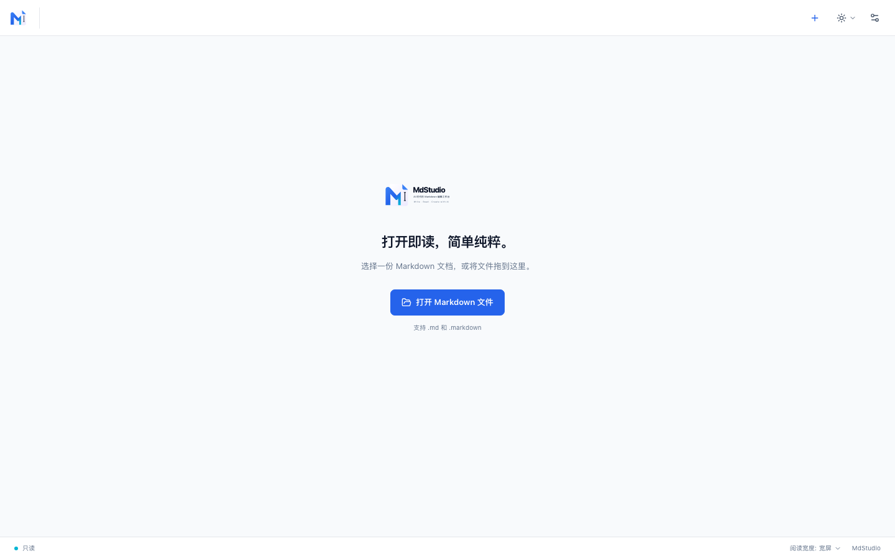
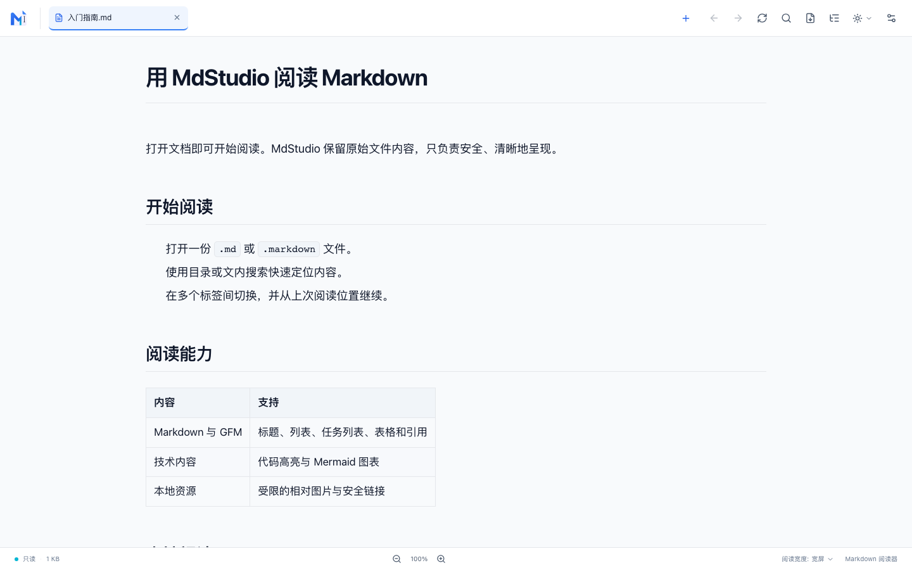
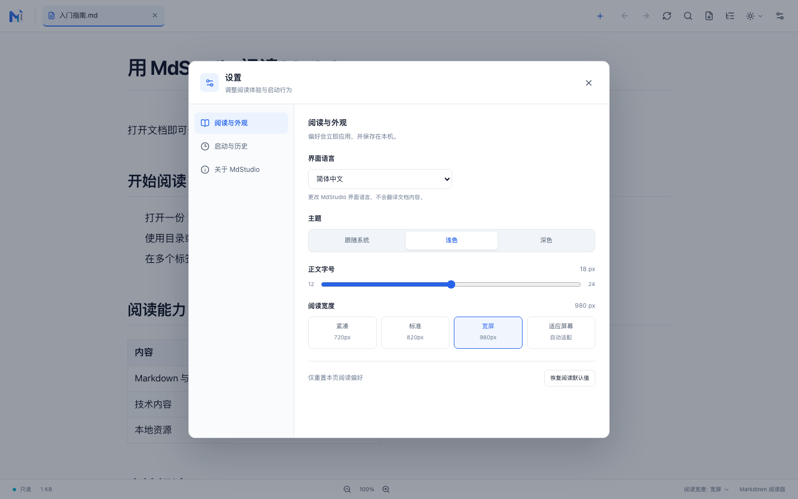
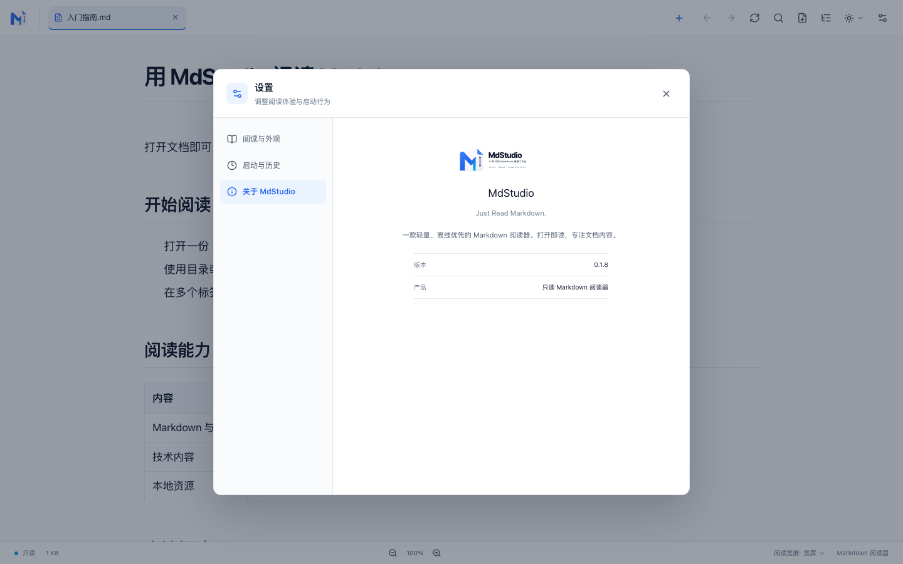

# MdStudio

[简体中文](README.zh-CN.md) · [English](README.md) · [日本語](README.ja.md)

**MdStudio v0.2.0** 是一款本地只读文档阅读器，支持 Markdown、PDF 和 OFD。打开文件即可阅读，并可在同一窗口使用多标签浏览。

> Just Read Markdown. 打开文档，即刻阅读。



## 界面截图

### Markdown 文档阅读



### 设置



### 关于 MdStudio



## 文档格式

| 格式 | 阅读能力 | 说明 |
| --- | --- | --- |
| Markdown（`.md`、`.markdown`） | Markdown/GFM、代码高亮、Mermaid、KaTeX 公式、GitHub Alerts、本地图片和链接 | 只读，不修改源文件。 |
| PDF（`.pdf`） | 连续阅读、页码导航、缩放、旋转、文字选择、搜索、缩略图及可用的大纲 | PDF.js、Worker 和所需资源随应用本地打包。扫描件不提供 OCR；加密 PDF 暂无密码输入。 |
| OFD（`.ofd`） | 本地页面阅读、导航、缩放、旋转、缩略图；存在文字层时可搜索 | 兼容性仍属实验阶段。缺少字体时中文可能空白；系统字体替代可改善部分文档，但安装包尚未内置中文兜底字体。显示印章不代表已验签。 |

当前应用支持文件选择、拖放及混合格式标签。系统文件关联和 Windows/Linux 行为尚未完成跨平台实测。

## 阅读功能

- 在同一窗口打开多个文档；每个标签独立保存阅读位置和搜索状态。
- Markdown 支持目录、文内搜索和前进/后退阅读历史；PDF/OFD 提供页码导航，并在可用时显示缩略图或大纲。
- 选择浅色、深色或跟随系统主题，调整 Markdown 字号和阅读宽度，支持“适应屏幕”。
- 界面提供简体中文、English 和日本語。
- 在设置中恢复上次打开的标签、记忆阅读位置及管理最近文件。
- Mermaid 图表和 LaTeX 公式使用随应用打包的本地资源，不依赖 CDN。

## 已知限制

- OFD 兼容性尚不完整。文档声明的字体或字形不可用时，部分文字仍可能缺失。暂不支持加密 OFD，也不会验证签章有效性。
- Markdown 转 PDF 与 PDF 阅读是不同功能。当前 Markdown 转 PDF 导出仍有已知问题，部分文档可能导致界面无响应或导出失败。
- Windows 和 Linux 尚未完成与 macOS 同等程度的桌面验证。

## 安全与数据边界

MdStudio 不会编辑 Markdown、PDF、OFD、图片或附件。阅读偏好、标签会话、最近文件路径和阅读位置仅保存在本机。文档不会上传，应用不使用云服务或数据库。

Markdown HTML 经过白名单清洗；脚本不会执行，危险 URL 会被移除，远程图片不会加载。相对资源会限制在文档目录内。HTTPS 链接仅在用户点击后交由系统浏览器打开。PDF.js、Mermaid、KaTeX 和 OFD Viewer 资源均随应用本地打包，可离线使用。

MdStudio 不包含 Markdown 编辑器、AI 对话、工作区、账户、云同步或插件系统。

## 安装与运行

### 使用 macOS 应用包

构建产物路径：

```text
src-tauri/target/release/bundle/macos/MdStudio.app
```

### 从源码运行

需要 Node.js、pnpm、Rust stable，以及 Tauri 2 对应平台的桌面开发依赖。配置说明见 [Tauri v2 前置条件](https://v2.tauri.app/start/prerequisites/)。

```bash
pnpm install
pnpm tauri dev
```

构建当前平台的桌面应用：

```bash
pnpm tauri build
```

仅构建 macOS `.app`：

```bash
pnpm tauri build --bundles app
```

前端生产构建命令为 `pnpm build`。

## 常用快捷键

| 操作 | 快捷键 |
| --- | --- |
| 打开文件 | `⌘/Ctrl + O` |
| 关闭当前标签 | `⌘/Ctrl + W` |
| 搜索当前文档 | `⌘/Ctrl + F` |
| 重置 Markdown 字号或页面缩放 | `⌘/Ctrl + 0` |
| 切换标签 | `Ctrl + Tab` / `Ctrl + Shift + Tab` |
| 设置 | `⌘/Ctrl + ,` |
| 阅读历史后退/前进 | `⌘ + [` / `⌘ + ]`；Windows/Linux 使用 `Alt + ←` / `Alt + →` |

快捷键以当前平台为准。顶部工具栏也提供文档、搜索、导航、主题、刷新和阅读历史操作。

## 技术栈

- 桌面端：Rust、Tauri 2
- Markdown：Comrak、Syntect、Ammonia
- PDF：PDF.js（`pdfjs-dist`）
- OFD：OFDRW Viewer UI 和 Engine
- 界面：React、TypeScript、Tailwind CSS、Vite

## 许可证

MdStudio 使用 [MIT 许可证](LICENSE) 发布。
