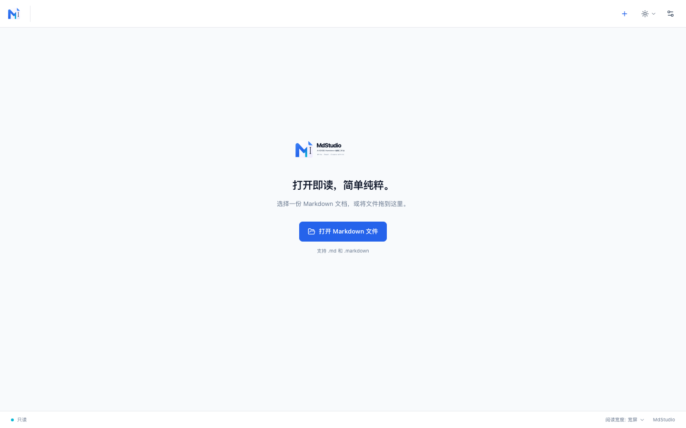
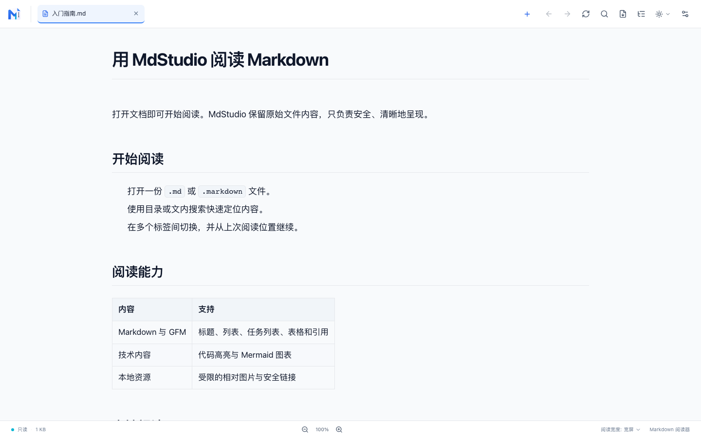
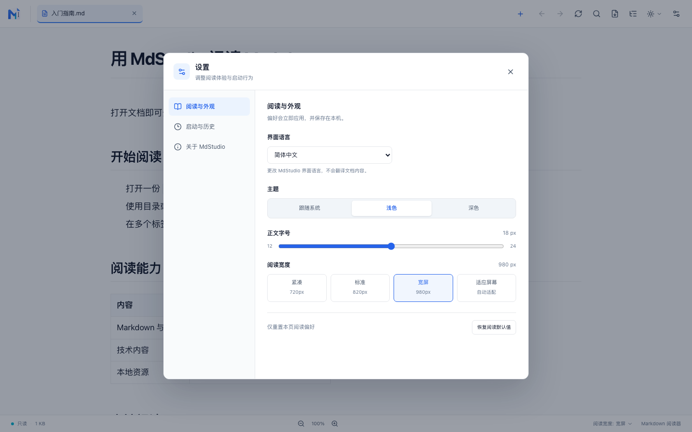
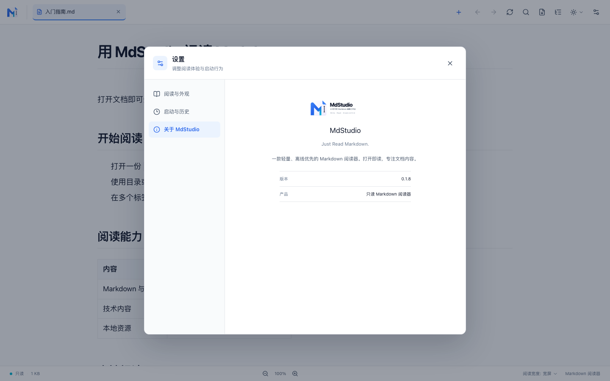

# MdStudio

[简体中文](README.zh-CN.md) · [English](README.md) · [日本語](README.ja.md)

**MdStudio v0.1.8** 是一款轻量、只读的 Markdown 桌面阅读器。打开文档即可阅读，支持多标签、技术文档渲染与本地阅读偏好。

> 打开即读，简单、快速、纯粹。



## 界面截图

### Markdown 文档阅读



### 设置



### 关于 MdStudio



## 功能

- 打开 `.md`、`.markdown` 文件：使用文件选择器、拖放，或通过系统打开方式启动；同一窗口可阅读多个文档。
- 阅读常见 Markdown 与 GFM 内容：标题、列表、任务列表、表格、引用、链接、图片和代码块；代码块支持本地语法高亮。
- 查看 Mermaid 图表：默认渲染，可查看或复制源码，也可在查看器中缩放、平移和适应窗口。
- 阅读本地文档资源：受限读取文档目录内的相对图片；表格和代码块可独立横向滚动。
- 使用目录、文内搜索和前进/后退导航定位内容；标签分别保存搜索状态与阅读位置。
- 选择浅色、深色或跟随系统主题，调整字号和阅读宽度；支持“适应屏幕”。
- 使用简体中文、English 或日本語界面。
- 恢复上次打开的标签、记住阅读位置，并从设置中管理最近文件。
- 在 macOS 和 Windows 代码路径中提供 A4 纵向 PDF 导出；PDF 页面隐藏阅读器工具栏及页眉页脚。Windows 运行环境未在当前项目验收记录中实测；Linux 不支持当前的直接 PDF 导出实现。

## 安全与数据边界

MdStudio 是只读阅读器，不会编辑或保存 Markdown，也不会修改图片。偏好、标签会话、最近文件和阅读位置只在本机保存，不缓存文档正文。

Markdown HTML 经过白名单清洗；脚本不执行，危险 URL 会被移除。相对图片须通过文档目录边界和文件类型校验，远程图片不加载。HTTPS 链接仅在用户点击后交由系统浏览器打开。应用不上传文档、不使用云服务或数据库。

MdStudio 不包含 Markdown 编辑器、AI 对话、工作区管理、账户、云同步或插件系统。

## 安装与运行

### 使用已构建的 macOS 应用

应用包由项目构建生成：

```text
src-tauri/target/release/bundle/macos/MdStudio.app
```

### 从源码运行

需要 Node.js、pnpm、Rust stable，以及 Tauri 2 对应平台的桌面开发依赖。配置说明见 [Tauri v2 前置条件](https://v2.tauri.app/start/prerequisites/)。

```bash
pnpm install
pnpm tauri dev
```

构建当前平台的桌面应用：

```bash
pnpm tauri build
```

仅构建 macOS `.app`：

```bash
pnpm tauri build --bundles app
```

前端生产构建命令为 `pnpm build`。

## 常用操作

| 操作 | 快捷键 |
| --- | --- |
| 打开文件 | `⌘/Ctrl + O` |
| 关闭当前标签 | `⌘/Ctrl + W` |
| 搜索当前文档 | `⌘/Ctrl + F` |
| 恢复默认字号 | `⌘/Ctrl + 0` |
| 切换标签 | `Ctrl + Tab` / `Ctrl + Shift + Tab` |
| 设置 | `⌘/Ctrl + ,` |
| 阅读历史后退/前进 | `⌘ + [` / `⌘ + ]`；Windows/Linux 使用 `Alt + ←` / `Alt + →` |

快捷键以当前平台和应用菜单为准。顶部工具栏也提供打开、搜索、目录、主题、刷新及阅读历史操作。

## 技术栈

- 桌面端：Rust、Tauri 2
- Markdown：Comrak、Syntect、Ammonia
- 界面：React、TypeScript、Tailwind CSS、Vite
- 图表：按需加载的 Mermaid；SVG 使用 DOMPurify 清洗

Mermaid 与字体等运行资源随应用本地打包，不依赖 CDN。

## 许可证

MdStudio 使用 [MIT 许可证](LICENSE) 发布。
